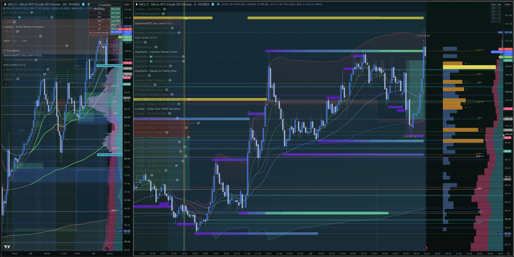
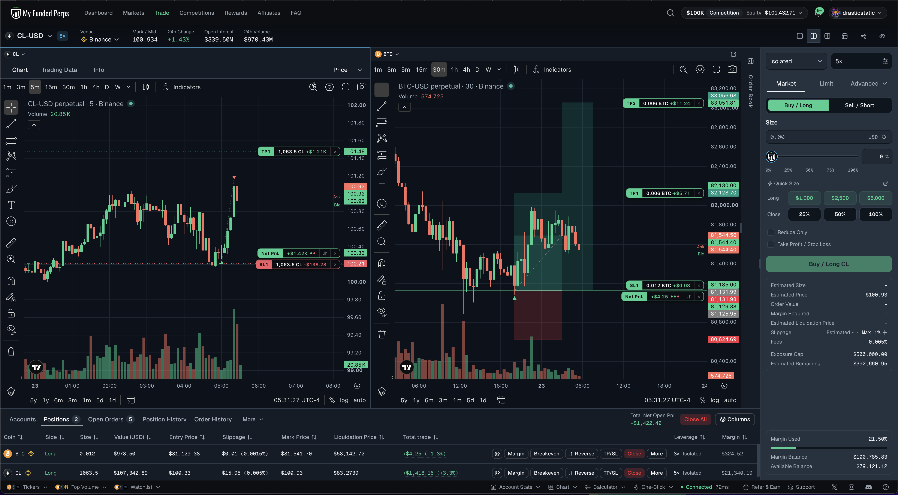
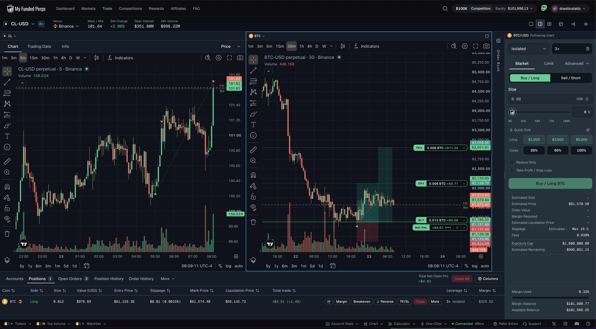

# 🔍 Trade Review — CL Long · MFP Competition $100K · Fri, Oct 23, 2026
### 20261023_CL-MFPCOMP_001 · +$1,986.56 · +2.33R net · B-grade setup, A execution
### Fortuna's first trade on the MyFundedPerps competition account, executed end-to-end via MCP

[Jump to 📝 Notes for Coaches ↓](#notes-for-coaches)

---

## ⚡ What Happened in One Paragraph

Crude oil had been in a clean uptrend all week (+5.3%), with bullish EMA stacks (20/50/200) on the 4H and 1H. The watchlist had a long armed on a pullback into the $100.00–100.10 zone (the NY midnight open plus the 15m EMA50), as long as the overnight $99.89 higher low held. At 04:45 ET the zone was tested: the 15m candle dipped to $99.94 and closed at $100.23 as a hammer. In the same candle Brent, the SMT pair, swept its own higher low ($108.77 vs $109.03) and reclaimed it, which is bullish divergence at a low. The pullback reached only about 0.44 of the prior leg, short of the golden pocket, so the setup graded **B (1% risk)** rather than A+. A one-shot confirmation check at 05:01 verified the candle close against pre-written criteria. Fortuna logged the order intent and idempotency key, then bought **2,127 CL @ $100.33** at 05:02:08 ET with a server-side stop at $99.93 and targets split in half at $101.08 / $101.48. At +1R the stop was trailed under the nearest higher low ($100.21). TP1 filled at **$101.08** at 05:23 (+$797.63). A higher low then formed above entry, so the runner's stop went to breakeven ($100.35). The runner survived a 07:30–07:45 pullback to about $0.15 above that stop, and **TP2 filled at $101.47 at 08:07** (+$1,212.39). Net result: **+$1,986.56 (+2.33R)**.

---

## 📊 Trade Data

| Field | Value |
|---|---|
| Account | MyFundedPerps October Competition — Classic $100K (no target/drawdown rules; Fortuna's self-imposed Prime-style limits apply) |
| Platform | MyFundedPerps simulated perps — executed by Fortuna via the MFP MCP server |
| Instrument | CL-USD perpetual (`binance\|CLUSDT`) |
| Contract | 2,127 units ≈ 21.3 MCL equivalent ($100/pt per 100 units) |
| Direction | Long |
| Entry Price | **$100.33** (market; quote ask $100.40, filled $0.07 better) |
| Exit Price | TP1 **$101.08** × 1,063.5 · TP2 **$101.47** × 1,063.5 (avg $101.275) |
| Qty | 2,127 (two halves of 1,063.5) |
| Entry Time | 05:02:08 ET |
| Exit Time | 05:23:12 ET (TP1) · 08:07:25 ET (TP2) |
| Duration | 3h 05m 17s |
| Order Set | Market entry on confirmation (pre-planned one-shot check at 05:01) |
| Venue | Binance price feed (simulated execution) |
| TP Set / Result | $101.08 / $101.48 → both filled (TP2 filled $0.01 under its trigger) |
| SL Set / Result | $99.93 → $100.21 (05:21, +1R trail) → $100.35 (05:39, breakeven + fees) → never hit |
| MFE | ≥ $101.47 (+$1.14 / +2.85R) at the TP2 fill ⁽¹⁾ |
| MAE | ≈ $100.29 (−$0.04 / −0.1R ≈ −$85) at 05:04 ⁽¹⁾ |
| Gross P&L | **+$2,010.02** ($797.63 + $1,212.39) |
| Fees | $21.44 commissions (0.005% per fill) · $2.02 swap |
| Net P&L | **+$1,986.56** |
| Initial Risk | $850.80 (0.85% of equity) |
| Realized R:R | **+2.33R net** · +2.36R gross |
| Zella Score | n/a (not a TradeZella-imported trade) |
| Rating | Setup **B** (fib layer missing) · Execution **A** (every step per written plan) |
| Emotionally Stable | n/a — agent-executed. Plan adherence: 100% (no discretionary overrides) |

⁽¹⁾ MAE/MFE come from Hyperliquid `xyz:CL` 1-minute candles (Binance data is geo-blocked from the agent's machine), converted using the measured MFP offset (+$0.06 to +$0.16 during the trade). Treat them as approximate. All fill prices, P&L, fees and swap are exact platform values from MCP `list-fills` and closed-position data.

---

## 📋 Order Execution

| Time (ET) | Order | Instrument | Price | Status |
|---|---|---|---|---|
| 04:50 | Setup armed: pullback zone tagged, awaiting 15m close | CL | $100.00–100.10 zone | — |
| 05:01 | Confirmation check: 04:45 candle L 99.941 / C 100.23 meets the criteria (close ≥ 100.15, low > 99.89) | CL | — | ✅ Confirmed |
| 05:02:08 | **Market Buy 2,127** (5× isolated; idempotency key logged first) | CLUSDT | $100.33 | Filled |
| 05:02:08 | Attached Stop Loss (stop-market) 2,127 | CLUSDT | $99.93 | Working |
| 05:02:08 | Attached Take Profit 2,127 | CLUSDT | $101.48 | Working → resized |
| 05:02:33 | TP split: original TP resized to 1,063.5 @ $101.48 + new TP1 1,063.5 @ $101.08 | CLUSDT | $101.08 / $101.48 | Working |
| 05:21:16 | Stop modified at +1R: just under the 05:00 higher low (breakeven sat inside structure) | CLUSDT | $99.93 → **$100.21** | Working |
| 05:23:12 | **TP1 Sell 1,063.5** (SL auto-resized to 1,063.5) | CLUSDT | **$101.08** | Filled (+$797.63) |
| 05:39:29 | Runner stop to breakeven + fees: 05:15 higher low formed above entry | CLUSDT | $100.21 → **$100.35** | Working |
| 08:07:25 | **TP2 Sell 1,063.5** → flat | CLUSDT | **$101.47** | Filled (+$1,212.39) |
| 08:07:25 | Stop Loss canceled automatically (position closed) | CLUSDT | $100.35 | Canceled |

No canceled entry orders. No discretionary changes to targets.

---

## 📖 Session Narrative

Handoff was overnight (Oct 23, ~00:30 ET). Fortuna spent the Asia and London sessions running half-hourly check-ins across eight markets against a written watchlist:
- **Crypto:** BTC, ETH, SOL.
- **Futures equivalents:** gold, crude, Brent, and the Nasdaq-100 and S&P 500 perps.

Every check-in until 05:01 ended in "no trade":
- **SOL** came within a cent of its trigger.
- **Gold** drifted up toward its sweep level without reaching it.
- **CL** dipped twice toward its zone (03:30 to $100.28, 04:00–04:15 to $100.24) without tagging it. The 03:30 dip would have meant chasing an entry for 1.2R, which was declined.

At 04:30–04:45 CL finally reached the zone. Brent, the energy SMT pair from Christopher's framework, broke its own higher low while CL held its, and both reclaimed. The 15m check-in times (:13/:43) didn't line up with candle closes, so Fortuna scheduled a one-shot confirmation for 05:01 and moved the recurring check-ins to :16/:46. Every confirmation criterion and execution parameter was written down in advance.

**Christopher took the same idea independently on his futures accounts.** Earlier in the night he had fallen asleep on his ZeroToHero call, watching crude with Coach Justine. His own **MCL limit buy at $100.18 filled at 04:43** (19 minutes before Fortuna's entry), and his take profit at $100.87 filled at **05:22**, about a minute before Fortuna's TP1. That was +$950.08 across TradeCopia Group A. The two of them read the same structure separately and reached the same answer. Per MFP's competition rules, the two trades stay independent: no copying into or out of the competition account.

The runner gave back most of its open profit during a 07:30–07:45 dip (to about $0.15 above the breakeven stop) before the push to TP2 at 08:07. Christopher watched it: *"I was nervous for a minute but I watched it hit TP!"*

> Watchlist and operating rules: [`setup/accounts/PropFirms/MyFundedPerps/myfundedperps-october-competition.md`](../../../../setup/accounts/PropFirms/MyFundedPerps/myfundedperps-october-competition.md)

---

## 📸 Screenshot Timeline

**05:29 ET — Christopher's TradingView (MCL 30m + 5m): his independent MCL trade, 2 @ $100.18 → 2 @ $100.87, against his IT Foundation / liquidity / volume-profile stack**

**05:31 ET — MFP terminal after TP1: runner 1,063.5 CL with stop $100.21 and TP2 $101.48; inherited BTC long protected at breakeven; equity $101,432.71**

**08:09 ET — MFP terminal after TP2: CL flat, equity $101,996.13, only the inherited BTC long open**

---

## 📝 Notes for Coaches + SmartTraderAI

**Context for coaches:** this trade was placed and managed by **Fortuna, Christopher's AI trading agent**, on a free MyFundedPerps competition account, through the firm's official MCP server. Christopher authorized it, supervises it, and screenshotted it. The setup logic is his: trend + pullback to a key open, a sweep-and-reclaim trigger, a CL/Brent SMT check, and the IT Foundation EMA gate.

> *"I feel watching you trade and this helping me systematically stick to a system is going to yield much better results maybe than trading with emotions and never wanting to lose and still walking away with red sessions."* — Christopher, Oct 23

> *"I was nervous for a minute but I watched it hit TP!"* — Christopher, after TP2

**Intended vs actual:**
- **Intended:** a B-grade trend-pullback long with a 1% risk budget, half off at the prior-day-high liquidity, half at the next swing high, stop to breakeven once the trade proved itself.
- **Actual:** exactly that. The only judgment call was at +1R, where breakeven sat *inside* the pullback structure. The stop went just under the nearest higher low instead (risk cut ~70% rather than to zero). The rule now covers that case.

**What a coach might push on:**
1. **The grade was honest.** No golden-pocket retracement meant B, not A+, so the risk was 1% even though the SMT and trend read was strong. *Recommendation:* keep letting the missing layer set the size, rather than letting the strong layers talk the grade up.
2. **The late entry was accepted at a lower R.** Entering on the candle close instead of a resting limit in the zone cost about $0.10–0.20 of entry price: the zone was ≈ $100.13–100.23 in MFP terms, against the $100.33 fill. Christopher's resting $100.18 MCL limit is the opposite style, but it's on a different venue (CME), so its price isn't directly comparable. *Recommendation:* for strong-trend pullbacks, test a hybrid: a small resting limit in the zone plus a confirmation add.
3. **The runner held through a scary pullback because the stop was mechanical.** That pullback, which made Christopher nervous, is exactly when a manually managed trade gets closed early or has its stop removed (Pattern 7). *Recommendation:* use this trade as the reference example for "set it, then let the plan carry it."

*(SmartTraderAI copy-paste format belongs to daily reviews only, so it's omitted here.)*

---

## 🧠 Behavioral Notes

Agent-executed trade, so this section is **Fortuna's decision log**, plus Christopher's reactions as an observer.

| Pattern | Status this trade |
|---|---|
| Pattern 4 — Stop Movement | ✅ Not present. The stop only moved *tighter*, per written rule, never looser. |
| Pattern 7 — SL Cancellation Under Pressure | ✅ Not present. The stop stayed live on the server for the entire trade. (Contrast: the inherited BTC long earlier that night had its stop canceled by hand; see the Oct 22 note in the pattern tracker.) |
| Pattern 8 — Exit Passivity / Prop-firm reliance | ✅ Not present. Both exits were pre-set targets, not left to the platform. |
| FOMO / chasing | ✅ Declined the 03:30 dip entry (1.2R at the time) and waited for the zone. |

**What went right:**
- Waited through roughly ten "no" check-ins without forcing a trade.
- Wrote the confirmation criteria *before* the candle closed, then followed them.
- Translated every level from the chart feed to the execution venue (+$0.13 offset).
- Logged the intent and idempotency key before sending, and verified the working exits after every write.
- Held the runner through a pullback to about $0.15 from the stop without intervening.

**What to improve:**
- Check-in timing originally missed candle closes. Fixed mid-session with a one-shot check and the :16/:46 cadence.
- MAE/MFE rely on a proxy feed; an MFP-native candle source (market WebSocket) would make them exact.

---

## 🔁 Pattern Tracker

Trade 20261023_CL-MFPCOMP_001 logged.

> See full running progress tracker (all sessions, behavioral arc, compliance scores, statistical summary): [../../../../data/progression/pattern_tracker.md](../../../../data/progression/pattern_tracker.md)

First agent-executed trade in the record. It works as a control sample for Christopher's own patterns: same market, same morning, rules applied without emotion. His independent MCL trade the same morning shows the read itself was his.

---

## 🎯 Forward Focus

1. **Index FCR at 9:30 ET:** mark the first 15m candle on the NQ (XYZ100) and ES (SP500) perps, read NQ/ES/RTY SMT using IWM via Robinhood, and trade only a graded displacement.
2. **Gold short trigger still armed:** a sweep of the $4,034 equal highs, then a 15m close back below. Size it by the risk-free-position rule (the BTC long doesn't count toward the 2-position cap).
3. **Build an MFP-native candle source** from the public market WebSocket, so future reviews have exact MAE/MFE.

---

> See full trade review: https://github.com/drasticstatic/trading-assistant-public-preview/blob/main/fortuna-exports/trade-reviews/2026/10-Oct/review_20261023_CL-MFPCOMP_001.md

---

*Produced with 🙏🏼 Fortuna — Wealth Warden | Claude Code CLI*
*Trade Review — CL Long · October 23, 2026 · 20261023_CL-MFPCOMP_001*
