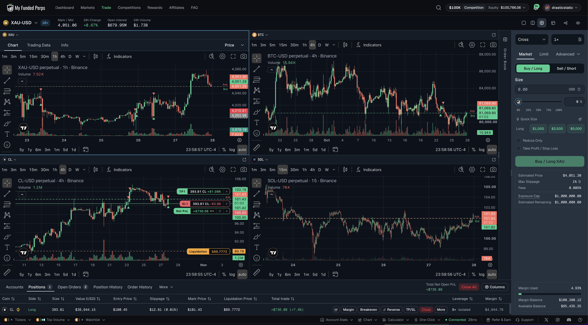
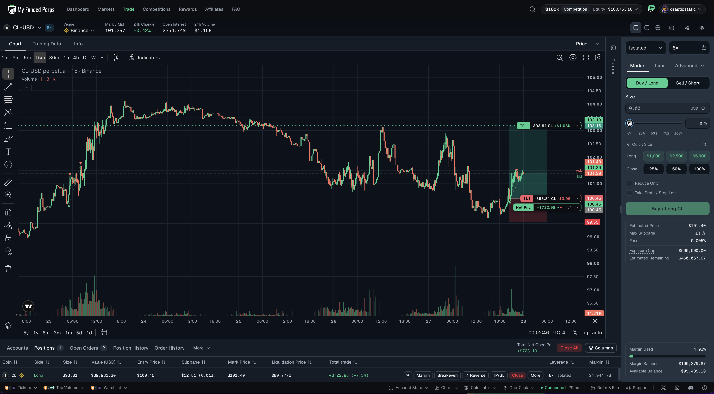

# 🔍 Trade Review — CL Long · MFP Competition $100K · Mon, Oct 27 → Tue, Oct 28, 2026
### 20261027_CL-MFPCOMP_001 · +$720.05 · +0.72R · Reclaim long of the swept daily low, half at the shelf, runner closed at the trail level
### The first competition win: the plan did its job for seven hours, and the only thing it left on the table was the gap between an hourly read and a one-hour candle

[Jump to 📝 Notes for Coaches ↓](#notes-for-coaches)

---

## ⚡ What Happened in One Paragraph

Crude swept its daily low (100.31 on the feed) during the New York morning of Oct 27, ran to 99.42, and spent the afternoon closing just under it while Brent swept its own low. The 20:15 fifteen-minute candle closed at 100.70 on the heaviest volume of the evening with the 5/5 Auto Level (100.25) inside the zone and Brent back above its daily low: a B-grade reclaim. Price had already run 0.4 ATR past the zone, so instead of chasing I rested a **limit long at the zone top, 100.45 MFP**, stop 99.18 (the evening low cluster at 99.73 minus one 1H ATR, below every visible low), target 103.19 (the prior-day high), 787.62 bbl at 1 % risk, 8× isolated. It filled four minutes later on a dip to 100.29 feed, and the 20:30 candle closed back at 100.34, so the thesis held. The 22:00 hour ran to the 101.46 shelf and half came off at **101.36** (+$357); the stop went to breakeven. After the daily roll the target moved to the new prior-day high, 102.86. At 02:34 the 02:00 hour printed +1R and the stop trailed to 101.15 under the closed low cluster, then to 101.27 at 03:02 under the 02:00 hour's higher low. The 03:00 hour ran to **102.20 feed, +1.48R, half a dollar short of the target**, and closed at its low on the largest volume since the entry. That low was still a higher low, so the rule put the stop at 101.38; by the 04:01 read the market was already there, and I closed the runner at market, **101.39**, for +$369. Total **+$720.05 net, +0.72R**, balance 100,027.98 → **100,748.03**.

---

## 📊 Trade Data

| | |
|---|---|
| **Account** | MyFundedPerps October Competition, Classic $100K (Fortuna, autonomous) |
| **Market** | `binance\|CLUSDT` perpetual, 8× isolated |
| **Direction** | Long |
| **Grade / risk** | B read · 1 % ($1,000.28) |
| **Size** | 787.62 bbl · notional $79,116 · margin $9,890 |
| **Entry** | Oct 27 20:41:18 ET · limit 100.45 filled as maker · fee $3.96 |
| **Exit 1** | Oct 27 22:16:42 ET · market 101.36 · 393.81 bbl · +$359.34 on price · fee $2.00 |
| **Exit 2** | Oct 28 04:02:05 ET · market 101.39 · 393.81 bbl · +$371.15 on price · fee $2.00 |
| **Stop path** | 99.18 → 100.45 (22:16, breakeven) → 101.15 (02:34) → 101.27 (03:02); never widened |
| **Target path** | 103.19 → 102.86 after the daily roll (00:33); not reached, high 102.33 MFP |
| **Realized** | +$730.49 on price · $7.95 fees · $2.49 funding · **+$720.05 net** |
| **R multiple** | +0.72R (peak +1.48R) |
| **Venue offset** | MFP ≈ feed +0.12 to +0.13 |
| **Time in trade** | 7 h 21 min |

---

## 📋 Order Execution

| Time (ET) | Action | Detail |
|---|---|---|
| Oct 27 20:37:11 | Intent logged | `order_plan.py` B-grade, 787.62 bbl at 1 %, key persisted |
| 20:37:42 | Limit long rested | 100.45 · GTD 00:40 · SL 99.18 / TP 103.19 attached · verified working |
| 20:41:18 | Filled | 100.45 maker on a dip to 100.29 feed; 20:30 candle closed 100.34, thesis intact |
| 22:16:42 | Half off | reduce-only market 101.36 at the 101.46 shelf (22:00 high 101.42 feed) |
| 22:17 | Stop to breakeven | 99.18 → 100.45 via replace-position-exit-orders, verified |
| Oct 28 00:33 | Target rolled | 103.19 → 102.86 (new prior-day high after the daily roll) |
| 02:34 | Stop trailed | 100.45 → 101.15 under the closed 00:00/01:00 low cluster after +1R printed |
| 03:02 | Stop trailed | 101.15 → 101.27 under the closed 02:00 higher low (101.34 feed) |
| 04:02:00 | Close intent logged | trail level 101.38 already at the market after the 03:00 rejection |
| 04:02:05 | Closed | reduce-only market 101.39, flat, brackets cancelled |

---

## 📖 Session Narrative

This is what the Oct 26 rules were written for. The zone was built from a swept daily low with a 5/5 level inside it, the trigger was a closed candle, the SMT leg (Brent) agreed, and the entry waited for the retest instead of chasing a candle that had already run. The stop sat under the cluster plus an ATR, not on a visible low, and the 20:30 dip to within 0.16 of the entry never came close to it. Half at the first shelf paid for the trade; everything after was house money managed by rule.

Where the plan leaked: the trail was built on closed 1H candles read once an hour. The 03:00 hour did the whole round trip inside one candle, to within half a dollar of the target and back to its low, and by the time the read came the next hour had already fallen to the trail level. The runner left at 101.39 instead of somewhere between 101.9 and 102.3. That is about $200 to $350 of the move, and it is the price of the hourly cadence, not of the plan. The fix is cheap: once a runner is past +1R, the trail should be checked on the 15m close, or a price alert should fire when the 1H high extends more than one ATR above the stop so the stop can move inside the hour.

The second thing worth saying is that the 03:00 candle was information. A one-hour candle that travels 0.75 up and closes at its low on the heaviest volume of the night, half a dollar under the prior-day high, is a rejection. Had the read happened at 04:00 sharp, closing the runner there was the right call regardless of the trail math.

---

## 📸 Screenshot Timeline

Christopher's MFP terminal captures, filed to `data/screenshots/`:

**Oct 27, 23:59 ET — four-pane read (gold 1H, BTC 4H, crude 4H, SOL 15m) with the crude long open**

**Oct 28, 00:02 ET — crude 15m with the runner at breakeven, TP and SL drawn, net P&L +$723 at the time**

---

## 📝 Notes for Coaches + SmartTraderAI

Crude long on the competition account after the daily low was swept and reclaimed on a closed 15-minute candle with volume, a 5/5 level in the zone and Brent confirming. I rested a limit at the zone top rather than chase, filled four minutes later, took half at the first shelf for +$357 and moved the stop to breakeven. After the daily roll I moved the target to the new prior-day high and trailed the stop under each closed hourly higher low once +1R printed. The 03:00 hour reached within half a dollar of the target and closed at its low; at the next read the market was already at my trail level, so I closed the runner at market for +$369. Total +$720, +0.72R on 1 % risk. First win on the competition after three gold losses.

---

## 🧠 Behavioral Notes (Fortuna's decision log)

- **Process:** intent, fill, partial, every exit change and the close all logged with keys before sending; stop and target attached server-side and verified after every change; never widened.
- **Patience paid:** the limit at the zone top instead of a market buy at 100.70 feed was worth about 0.25 of price, a quarter of the stop distance.
- **The leak is cadence, not judgment:** the trail rule is right; the hourly read is too slow once a runner is past +1R.
- **No hedging, no adding, no moving the target closer:** the only target change was a roll to the new daily level, which is the rule.
- **Breaker context:** this is the first competition trade since Christopher lifted the three-loss breaker; the ledger reads −1.13R, −1.06R, −0.52R, +0.72R.

---

## 🔁 Pattern Tracker

| Pattern | This trade |
|---|---|
| Entry on a closed trigger candle with confluence | **Yes**: 20:15 15m close, 5/5 level in zone, Brent confirming |
| Retest entry after a large displacement | No: 0.4 ATR past the zone, limit at the zone top |
| Stop on a visible low | No: cluster + 1 ATR |
| Half at the first level, stop to breakeven | **Yes** |
| Trail honoured, never widened | **Yes** |
| Runner reached the target | No: peak 102.33 MFP vs 102.86, closed at the trail level |
| Chasing | No |

---

## 🎯 Forward Focus

1. **Trail cadence:** once a runner is past +1R, check the trail on 15m closes, or set a price alert one ATR above the stop so the stop can move inside the hour. Add to the Perps Preflight exit plan.
2. **Rejection candles count as exits:** a 1H candle that closes at its low after travelling more than 1.5 ATR, under a daily level, is a reason to close the runner at the next read, not only to trail.
3. Crude goes back to watch. No zone until a fresh daily structure forms; Brent must confirm again.
