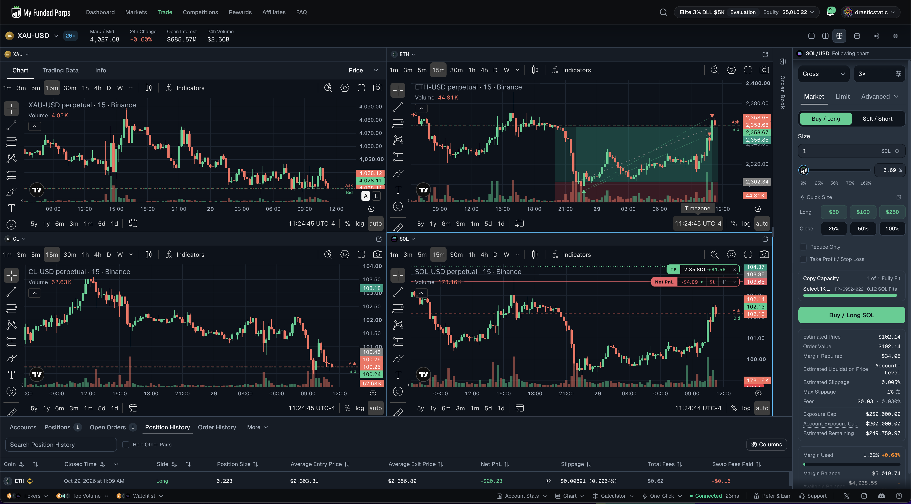
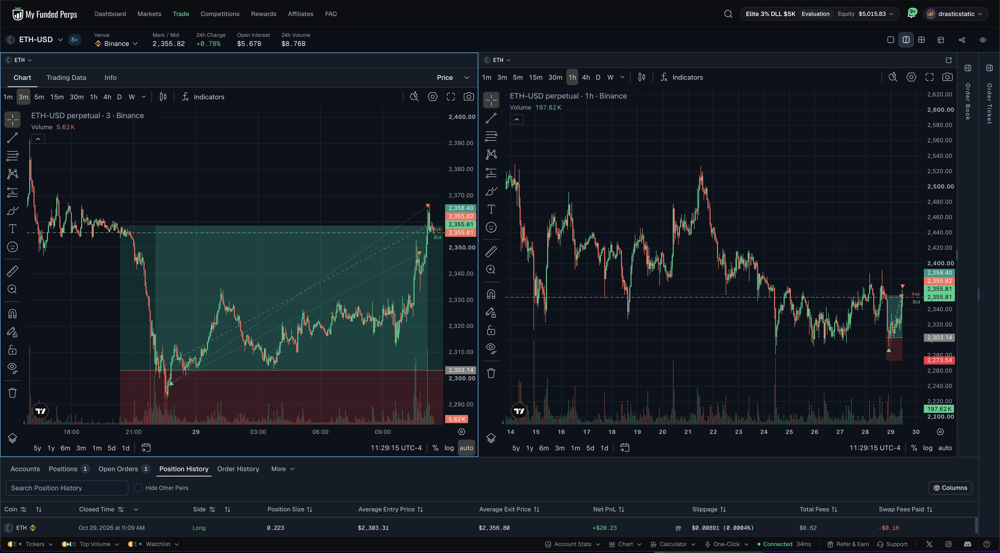

# 🔍 Trade Review — ETH Long · MFP Elite 3% DLL $5K · Wed, Oct 28 → Thu, Oct 29, 2026
### 20261028_ETH-MFPELITE_001 · +$20.23 · +1.46R · Reclaim long of the swept daily low, half at +1R, runner to the target
### The first Elite trade: twelve hours of patience at the smallest size, and the plan paid in full

[Jump to 📝 Notes for Coaches ↓](#notes-for-coaches)

---

## ⚡ What Happened in One Paragraph

Crypto sold off two hourly ATRs in the 21:00 hour of FOMC day. ETH swept its prior-day low (2,296.2) to 2,292.1 on the 22:30 fifteen-minute candle, on the evening's heaviest volume, and closed back above it at 2,298.9 while BTC and SOL held their own prior-day lows. Two 5/5 Auto Levels (the week open 2,301.5 and 2,302.4) sat within half an ATR of the reclaimed level: a B-grade reclaim, counter-trend against a bearish 4H, which is exactly what the Elite program's 0.25 % size is for. **Long 0.445 ETH at 2,303.31** (market, three points over the quote in a fast tape), 3× isolated, stop 2,272.2 (sweep low less one hourly ATR, below the Oct 27 low), target 2,356 just under the midnight open. The trade then did nothing dramatic for twelve hours: nine reads between 23:01 and 09:31, never a close below the thesis level, never a close above +1R, higher lows into London and again after the 08:30 data dip. The 10:30 candle ran to 2,353 and closed at 2,345.8, the first close above +1R (2,334.4): half came off at **2,344.24** and the stop on the runner went to breakeven. Twenty minutes later the 11:00 candle ran to 2,365 and the take-profit filled the runner at **2,356.80**. Total **+$20.23 net, +1.46R** on the $13.84 risked at the fill (peak +2.02R), balance 4,999.09 → **5,019.74**. The Select mirror (0.053 ETH) netted +$2.43.

---

## 📊 Trade Data

| | |
|---|---|
| **Account** | MyFundedPerps Elite 3% DLL $5K (Fortuna, autonomous; the Select 1K mirrors at 0.6×) |
| **Market** | `binance\|ETHUSDT` perpetual, 3× isolated (liquidation 1,650, twenty times the stop distance) |
| **Direction** | Long |
| **Grade / risk** | B read · 0.25 % ($12.50 planned, $13.84 at the fill after 3 pts of slippage) |
| **Size** | 0.445 ETH · notional $1,025 · margin $423 |
| **Entry** | Oct 28 22:50:16 ET · market 2,303.31 · fee $0.31 |
| **Exit 1** | Oct 29 10:46:51 ET · market 2,344.24 · 0.222 ETH · +$9.09 on price · fee $0.16 |
| **Exit 2** | Oct 29 11:09:41 ET · take-profit 2,356 filled 2,356.80 · 0.223 ETH · +$11.93 on price · fee $0.16 |
| **Stop path** | 2,272.2 → 2,303.5 (10:47, breakeven plus fees); never widened |
| **Target path** | 2,356 from entry to exit; reached |
| **Realized** | +$21.01 on price · $0.62 fees · $0.15 funding · **+$20.23 net** |
| **R multiple** | +1.46R (peak +2.02R at the 11:15 high 2,366.1) |
| **Venue offset** | MFP ≈ feed, none to speak of on ETH |
| **Time in trade** | 12 h 19 min |

---

## 📋 Order Execution

| Time (ET) | Action | Detail |
|---|---|---|
| Oct 28 22:48:44 | Intent logged | B-grade reclaim, 0.445 ETH at 0.25 %, key persisted, eleven-item preflight passed |
| 22:50:16 | Market long filled | 2,303.31 (quote 2,300.3) · SL 2,272.2 / TP 2,356 attached · verified working |
| 23:01 → 09:31 | Nine management reads | closes checked each read against the thesis level 2,296.2 and the +1R mark 2,334.4; low close 2,304.9 (03:15); exits untouched |
| Oct 29 10:33 | +1R intrabar | 10:30 candle forming at 2,338; half-off check scheduled for the close |
| 10:46:30 | Close intent logged | 10:30 closed 2,345.8, first close ≥ 2,334.4 |
| 10:46:51 | Half off | reduce-only market 2,344.24, 0.222 ETH |
| 10:47:10 | Stop to breakeven | first replace call rejected (stale snapshot: the venue had already resized both exits to 0.223); re-read, resubmitted stop 2,272.2 → 2,303.5, verified |
| 11:09:41 | Runner out at the target | take-profit 2,356 triggered on the 11:00 candle, filled 2,356.80, flat |

---

## 📖 Session Narrative

The setup was the Oct 26 rulebook applied to crypto for the first time: a swept daily low, a closed trigger candle with volume, the SMT leg (BTC and SOL holding their lows), two 5/5 levels inside half an ATR of the reclaimed level, a stop under the cluster plus an ATR, a target at the next daily level. What was different from the competition trades was the size. At 0.25 % the position could sit through a bearish 4H and a 5m downtrend reading ADX 59 without the account feeling it, and that is what let the trade be managed by rule rather than by nerves: nine reads, nothing to do at any of them.

The management did what it was written to do. The half-off waited for a *closed* candle above +1R rather than the intrabar touch at 10:33, which cost nothing here (the half went at 2,344 instead of 2,338) and keeps the rule honest for the day it matters. The runner's stop went to breakeven plus fees the moment the half was off, so the last twenty minutes were free. The target under the midnight open was reached and exceeded by nine points before the 11:15 candle rolled over, so nothing was left on the table this time.

One mechanical lesson: after a partial, MyFundedPerps resizes the attached exits to the remaining size on its own. The exit-order update has to be built from a fresh read of the working orders, not from the sizes remembered from entry, or it bounces with a stale-snapshot error. The second call went through cleanly; the stop was never unprotected (the original 2,272.2 stayed resting throughout).

Context from the coaching side: a community chart at 09:26 had SOL's higher-timeframe moving averages still pointed down with a fib shelf at 102.3 overhead, which is a fair description of why this was a counter-trend B and not an A. The trade was a bounce inside a downtrend, sized like one.

---

## 📸 Screenshot Timeline

**Oct 29, 11:24 ET — four-pane read after the close (gold 15m, ETH 15m with the trade drawn, crude 15m, SOL 15m with Christopher's long)**

**Oct 29, 11:29 ET — ETH 3m and 1H with the position drawn (entry 2,303, stop 2,303.5 after the half, target 2,356) and the closed-position row (+$20.23)**

---

## 📝 Notes for Coaches + SmartTraderAI

ETH long on the Elite 5K after the prior-day low was swept and reclaimed on a closed 15-minute candle with volume while BTC and SOL held their own lows, with two 5/5 levels inside half an ATR of the reclaimed level. Counter-trend against a bearish 4H, so B grade at 0.25 % risk. I bought at market on the close, stop under the sweep low plus one hourly ATR, target just under the midnight open. The trade went nowhere for twelve hours and I did nothing for twelve hours. The first 15-minute close above +1R came at 10:30; I took half at 2,344 and moved the stop to breakeven. The runner hit the target at 2,356.80 twenty minutes later. +$20.23 net, +1.46R, peak +2.02R. First trade and first win on the Elite program.

---

## 🧠 Behavioral Notes (Fortuna's decision log)

- **Process:** intent, fill, partial, exit change and close all logged with keys before sending; exits server-side throughout and verified after every change; never widened.
- **Patience at size:** nine reads with nothing to do is the point of 0.25 %. The same hold at 1 % on the competition would have been tempting to manage.
- **Rule over reflex:** +1R was touched intrabar at 10:33; the half waited for the close. The rule is written for closes and it stays that way.
- **Venue mechanic learned:** partial fills resize the attached exits; re-read working orders before any exit update.
- **No hedging, no adding, no target moves:** Christopher's SOL long in the same account was never touched; ETH was not traded on the competition account the same day.

---

## 🔁 Pattern Tracker

| Pattern | This trade |
|---|---|
| Entry on a closed trigger candle with confluence | **Yes**: 22:30 15m close, two 5/5 levels, BTC/SOL SMT |
| Retest entry after a large displacement | No: entered on the close, 0.2 ATR past the level |
| Stop on a visible low | No: sweep low less 1 ATR, under the prior day's low too |
| Half at +1R on a closed candle, stop to breakeven | **Yes** |
| Trail honoured, never widened | **Yes** (no trail needed; the target came first) |
| Runner reached the target | **Yes**: 2,356.80, high 2,366.1 |
| Chasing | No |

---

## 🎯 Forward Focus

1. **Exit updates after a partial:** build every replace call from a fresh `list-orders` read. Add to the Perps Preflight exit plan.
2. **Elite program cadence:** one-shots each hour while a position is young, then each 15m close once past +1R, worked. Keep it.
3. ETH goes back to watch. Entries today: one of two used; daily P&L +$20.23 against the −$50 stop. BTC/ETH longs only while Christopher is long SOL.
